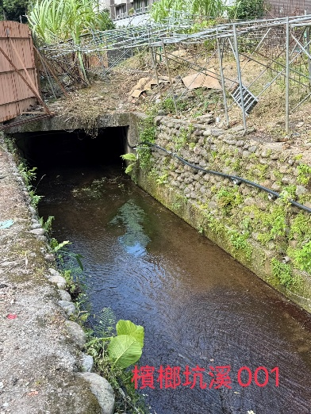
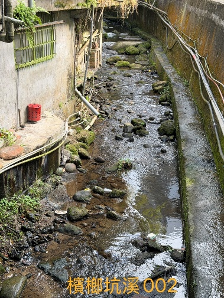
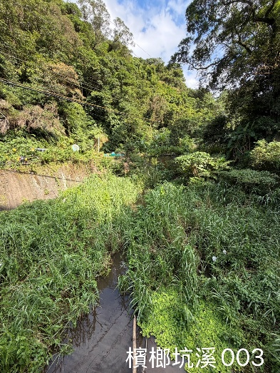
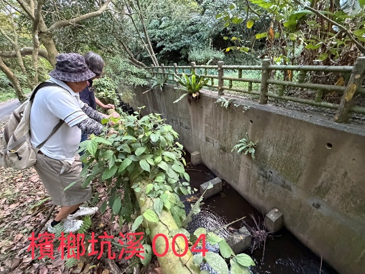
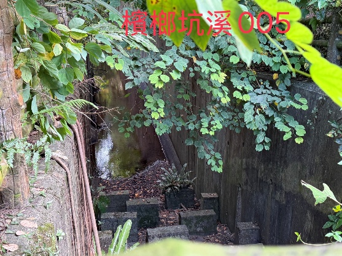
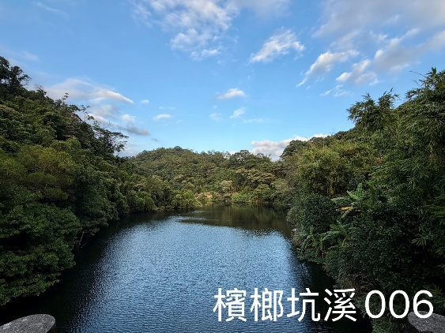
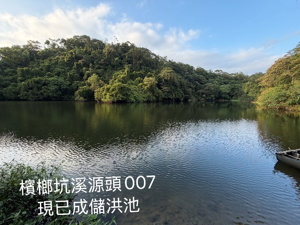
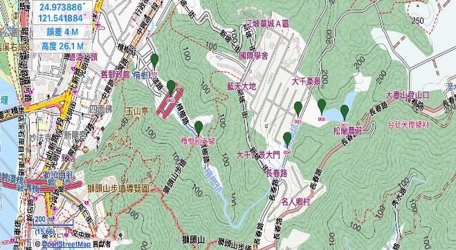

用河川閱讀歷史｜秋季班

2026.09.24｜從大坪林圳到檳榔坑溪，尋找河流與城市的記憶

秋高氣爽，陽光正好。9月24日，淑華老師帶領我們從新店捷運站出發，展開一趟充滿地方故事的踏查旅程。

我們經過大坪林圳，沿著中興路，來到獅頭山腳下的廣明寺、廣照寺，再沿著昔日振山煤礦的台車道前行，轉入檳榔坑。沿著檳榔路進入山間小巷，循著檳榔坑溪一路溯源而上，經過福民橋，探訪振山煤礦遺跡。最後來到檳榔坑頭福德宮，大家圍坐交流、分享一路上的觀察與發現。

午後天氣晴朗，下課後還留著一段天光。於是玉芳邀請老師和班長搭乘綠9公車，前往小獅山山腰、高麗坑山間的新坡一街和長春路，繼續追尋檳榔坑溪的源頭。

站在溪流源頭附近，不禁讓人想起多年前，長春路曾因大雨與溪流沖刷造成坍方。今年新坡一街邊坡在大雨後又崩塌坍方。檳榔坑溪源頭於20幾年前改建為儲洪池（蓄洪池），由於鄰近山坡地，台灣的河川與山坡地水流普遍具有「短、急、快」的特性。每當面臨颱風、豪雨或短時間的強降雨時，山區會產生大量的地表逕流（山洪水）。為了避免暴雨引發的山洪直接沖刷下游住宅區、減輕當地排水系統的負擔並防止積淹水災情，政府相關單位因而規劃興建此座蓄洪池，在暴雨來臨時將洪水暫存於池中，再適度排放，以保障周邊里民的生命財產安全。

山林開發成大型住宅社區，而在社區上方，原本自然蜿蜒的野溪檳榔坑溪，源頭成為蓄洪池，溪流河道也被整治成又深又窄的三面光排水溝。

我們一路溯源檳榔坑溪，看見的其實不只是溪流，更是都市發展和山坡地開發興建大型社區留下的痕跡。

人為開發與自然環境之間，始終存在著拉鋸，也不斷尋找著彼此妥協的方式。

昔日五峰國中後方的山林野溪，也曾是孩子們生活記憶中的一部分；如今，隨著都市發展，溪流逐漸成為水泥化排水溝或是隱沒入地下，成為看不見的暗渠。

這天的實地踏查大坪林圳和檳榔坑溪，從農田灌溉水源到都市臭水溝，從自然溪流到三面光排水溝，從明渠到地下暗渠……一路走來，看見的不只是水路的變化，更是一座城市在發展過程中，與山林、溪流和土地之間不斷調整的關係。

一條水圳、一條溪流的變化，也映照著一座城市的發展與生活方式。「用河川閱讀歷史」，讀的不只是溪流，更是土地、產業、聚落與人們共同走過的生活痕跡；而在讀懂過去之後，也讓我們重新思考未來——如何在城市發展與自然環境之間找到更好的平衡，讓溪流不只是排水的通道，也能重新成為城市與土地之間的生命脈絡。

謝謝淑華老師的帶領，從認識河川開始，關心我們生活的土地；從理解過去開始，思考未來的選擇。讓河流有呼吸的空間，讓城市與自然共好，也讓我們一起走向更友善、更韌性、更永續的生活。

