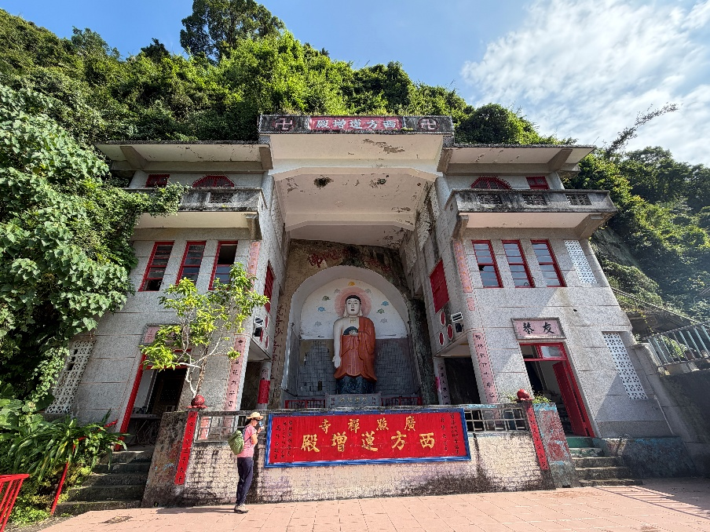

新店小獅山巖崖上的大佛與寺院——踏查心得

記得十數年前，只要從新店碧潭一帶向東方山林望去，總能看見矗立於小獅山山壁之上的阿彌陀佛大佛像。那尊大佛曾是獅山崖壁醒目的地標，靜靜看著西方，守望著新店。

然而，曾幾何時，一棟棟高樓陸續興建，逐漸遮蔽了山林與天際線的視野，大佛也隱沒在高樓大廈之後。昔日抬頭可見的身影，如今已不再容易尋覓。

民國八十幾年開闢的中興路，在光明街（廣明路）與小獅山腳之間劃出一條筆直寬敞的大道。前往廣明禪寺、廣照禪寺，不再需要從光明街穿梭蜿蜒的小巷，寺院山門就位於道路旁。原以為交通便利能為古老寺院帶來更多人潮，然而實際上，路過中興路的人們往往只是經過寺門而不入，便利的交通反而更凸顯寺院的寂寥與幽靜。

2026年9月24日，在淑華老師帶領下，師生進行一趟實地踏查。我們從新店捷運站出發，走向小獅山腳，再拾級而上小獅山腰，先後探訪景福寺（頂七張福德宮）、廣明禪寺大雄寶殿，以及廣欽老和尚開山紀念堂。

新店廣明寺（原名廣明巖）位於獅頭山（小獅山）山腰，是當代佛教高僧廣欽老和尚於民國三十七年來到台灣後駐錫、開山的第一個道場。沿著山徑登臨，不僅可以感受寺院清幽的環境，也能從山壁與周遭景致中，想見當年廣欽老和尚在此修行、開山的歷史足跡。

大雄寶殿後方的廣欽老和尚開山紀念堂，山壁間有三個洞窟，中間安置廣欽老和尚頭部雕塑。站在此處，面對山壁與寺院遺跡，更能感受到這片山林所承載的宗教歷史與人文記憶。

離開廣明禪寺後，我們回到中興路，再次踏上長長的階梯，前往相鄰的廣照禪寺。秋老虎炙熱陽光下，我們有如朝聖者，彼此鼓勵、揮汗登上一級級階梯，抵達廣照禪寺並瞻仰被高樓遮掩、久違的阿彌陀佛大石佛。

今日的廣照禪寺顯得冷清，應該少有香客與遊客登訪。然而，這尊阿彌陀佛大石像在臺灣佛教藝術與大型石雕發展史上，具有不可忽視的歷史意義。它曾經是新店山林的重要地標，也見證了地方宗教文化與時代變遷。令人惋惜的是，如今大佛周圍設置了許多塔位，骨罈、往生蓮座及長生祿位等設施，使得原本具有歷史與景觀價值的空間，逐漸失去其應有的整體環境與文化氛圍。

這次踏查讓我深深感受到，許多歷史文化遺跡並不是消失於一夕之間，而是在時代變遷與城市發展中，一點一滴被人們遺忘。阿彌陀佛大石像與廣明禪寺開山紀念堂，都是新店珍貴的宗教文化記憶，值得被看見、被保存，也值得後人重新認識。

衷心期盼相關單位能重視阿彌陀佛大石像及廣明禪寺開山紀念堂等宗教文化資產，積極協助寺院進行環境整理與文化保存，在兼顧宗教使用與歷史價值的前提下，改善周遭景觀和設施，讓這些逐漸被遺忘的文化遺跡重新被看見。

期待有一天，阿彌陀佛大石像不再只是隱身於高樓與塔位之間的歷史身影，而能重新成為新店碧潭獅山巖壁的文化地標；也期待廣明、廣照兩座禪寺所承載的宗教歷史，能與山林生態、地方文化及城市發展重新連結，形成一條兼具宗教、人文、歷史與景觀特色的文化路線，讓這股沉寂已久的文化泉源再次湧動，成為新店珍貴的文化資產。

