盧 淑

2026 年 10 月 1 日 瑠公圳走讀

從瑠公圳源頭、水利遺構，到老宅、力行營區與都市水圳

特別感謝高淑華老師的帶隊、指導與校正，讓這次走讀紀錄能更完整，也更貼近當天的實際內容。

走讀路線：瑠公圳引水原址 → 碧潭堰與引水石硿 → 萬善同歸 → 蔡金木宅 → 過水橋 → 許碧燕女士家 → 力行營區 → 瑠公圳親水公園 → 美河市附近

【2026-10-01-01】瑠公圳的源頭——從碧潭開始

瑠公圳的取水口位於新店碧潭的新店溪畔。2026年10月1日，我們來到國道3號橋下，親眼看見瑠公圳引水原址，也看見留下來的水利設施與瑠公史蹟紀念碑。

瑠公圳的歷史，最初可以追溯到郭錫瑠從青潭溪一帶尋找水源的規劃；後來因工程艱鉅與水權等因素，轉向碧潭一帶取水。因此，青潭與碧潭在瑠公圳的歷史中，各自留下了不同的位置：青潭與早期開圳的規劃及工程有關，而碧潭則成為後來瑠公圳重要的取水圳頭與引水原址。

資料記載，1767年取水口移至今天高速公路下方的瑠公圳引水紀念碑附近。

站在這裡，我們看到的不只是「瑠公圳」三個字，而是一個可以追溯瑠公圳取水歷史的重要現場。從新店溪取水，經過水門，再進入瑠公圳；眼前所見的水利設施，也讓早期的水利工程不再只是書本上的文字，而成為可以親眼看見的地方。

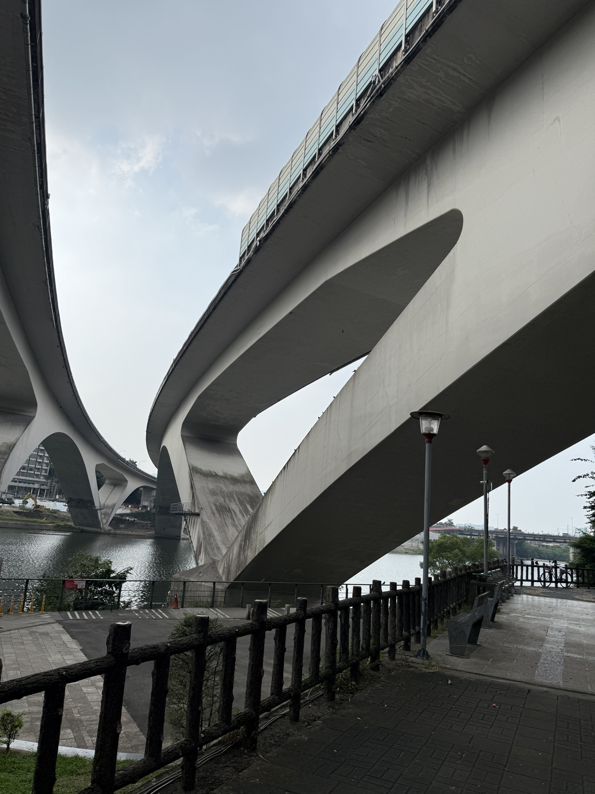

國道3號橋下的瑠公圳引水原址。

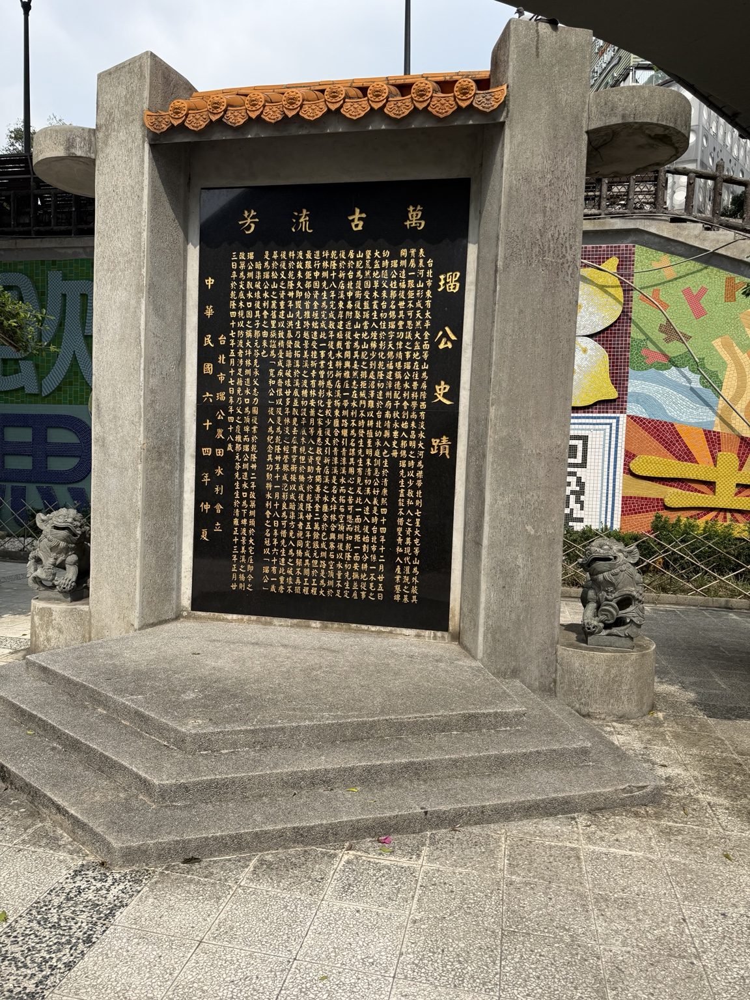

「萬古流芳」瑠公史蹟紀念碑。

【2026-10-01-02】飲水思源——原來的水門就在這個高度

走到瑠公圳引水原址，最讓人印象深刻的，是「飲水思源」所留下的歷史位置。

資料記載，舊水門位在較高處，而今天下方所看到的「水門」，是後來設置的意象裝置。這個高低位置，也成為觀察新店溪水位變化的一個歷史痕跡。

也就是說：

以前真正的水門在上方。現在看到的下方水門，並不是原來的水門。

這個綠色手輪是現場可以看到的水門控制設施。瑠公管理處的資料也記載，後來水門開關曾改為機械化的捲揚機方式。

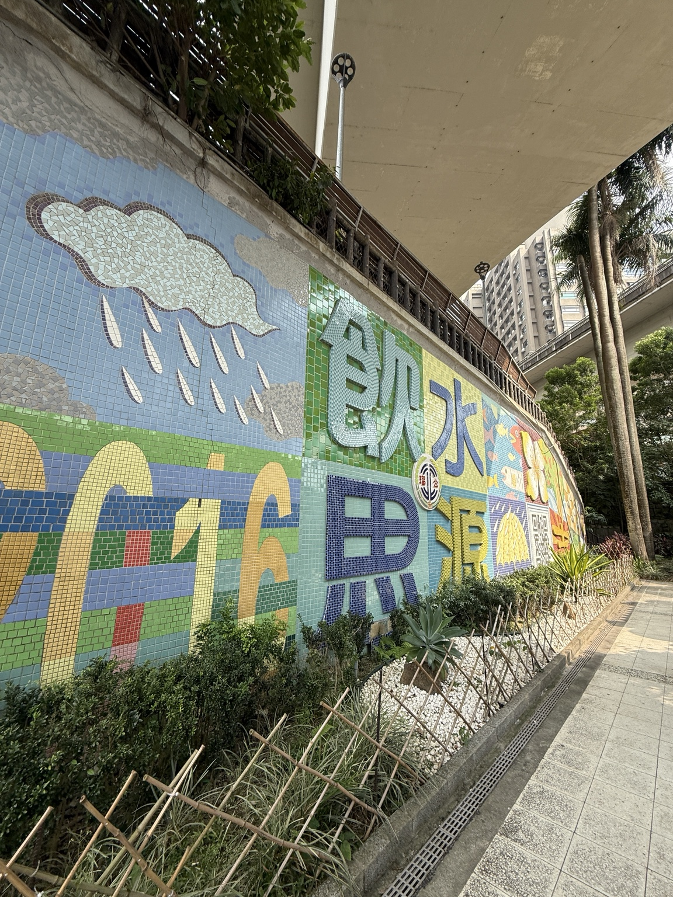

「飲水思源」瑠公圳水文化意象牆。

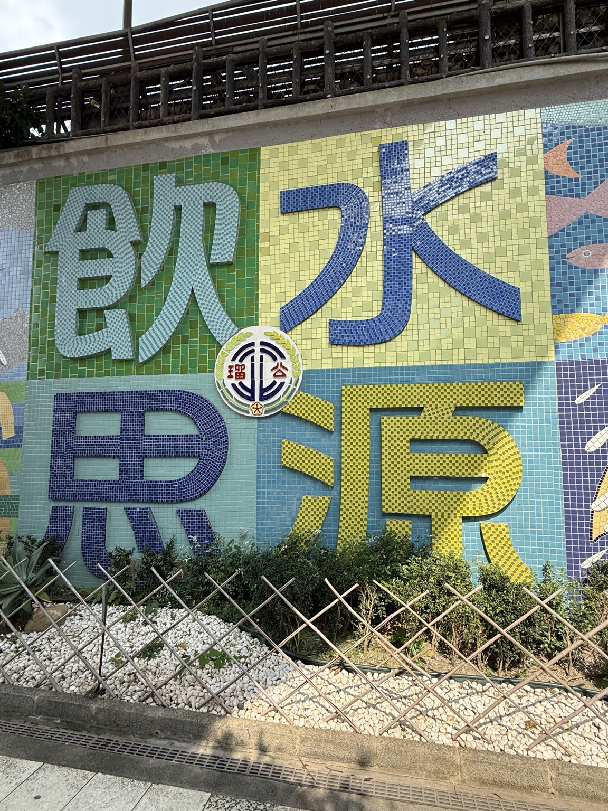

「飲水思源」。

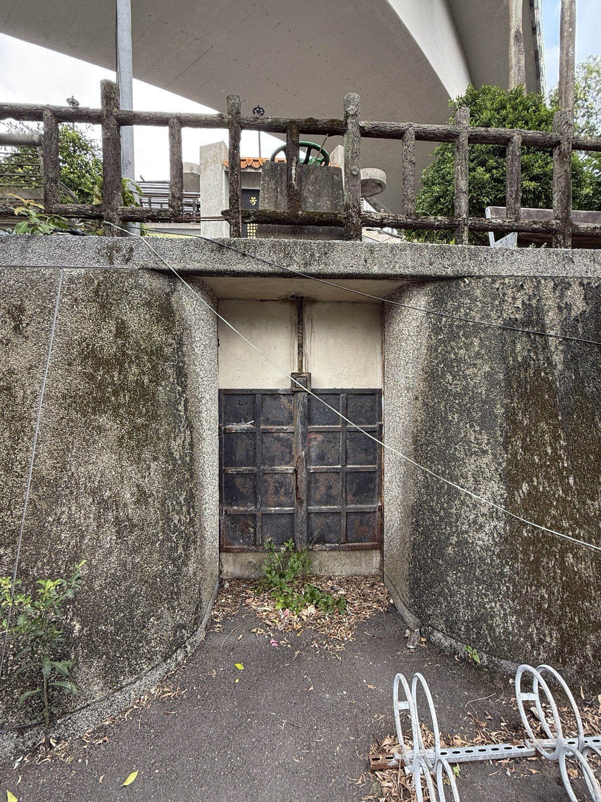

原來的水門意象。

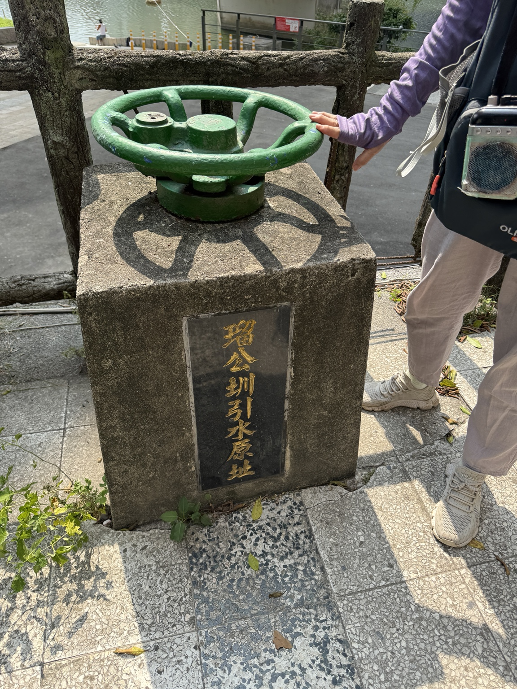

今ㄖ瑠公圳引水原址的綠色控制手輪意象。

【2026-10-01-03】碧潭堰與引水石硿

走上階梯，視線也跟著往上。隨著腳步一階一階升高，原本在下方看到的水利設施，開始換了一個角度；而就在這個上行的過程中，一面充滿水圳意象的裝飾牆映入眼簾。《這面牆在意象水門的上方。》

那一刻，我覺得這面牆並不只是一面裝飾牆。它像是一幅把地方故事濃縮在眼前的圖像，讓原本分散在歷史資料裡的水圳、魚群與農田，忽然有了可以直接看見的形狀。

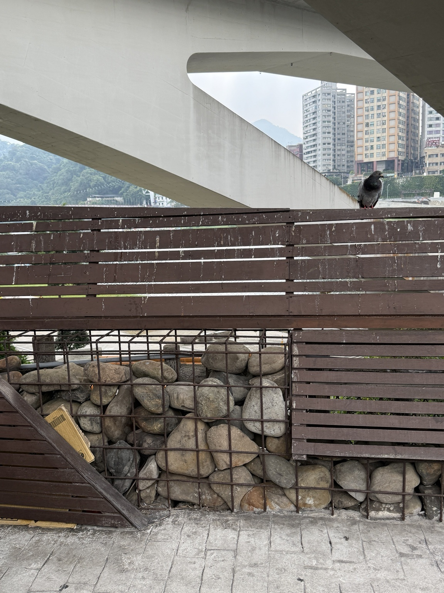

瑠公圳原來制水把手的地方

水圳像一條延伸的線，牽引著我們的目光；魚群像流動的生命，提醒我們水不只是被輸送的資源，也是一個地方得以生長、繁衍的條件；而農田則讓這條水路的意義更加清楚——水被引來之後，進入土地，滋養作物，也支撐起人們的生活。

接著看到《新店區行動圖書館-碧潭》的碧潭堰水利導覽圖，從現場的瑠公圳的取水口，追溯到瑠公圳的發源地引水石硿，想起2024年12月走讀石硿的驚艷。

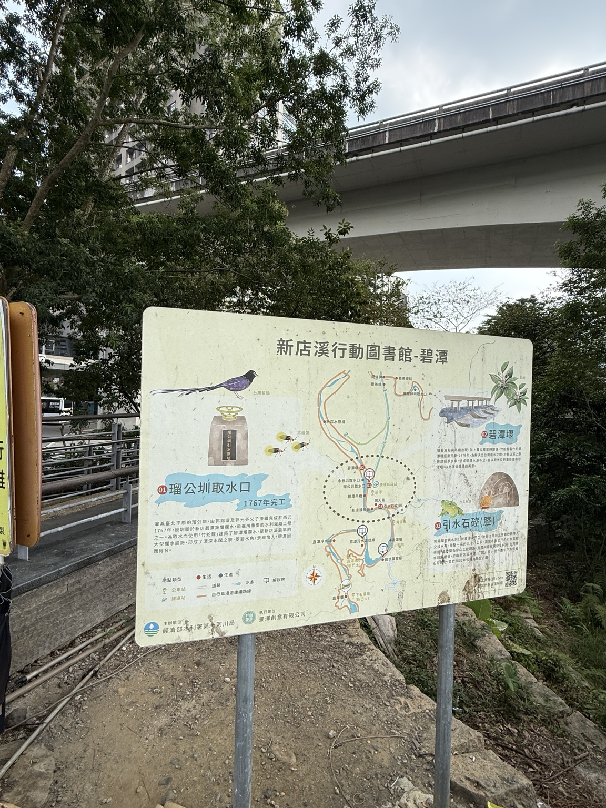

引水石硿內部。

石硿岩壁上仍清楚可見先民一刀一斧開鑿留下的痕跡；而牆面上若隱若現的亮色線條，則留下了過去水流經過的水位痕跡。眼前的岩壁，彷彿同時保存了「人力開鑿」與「水流經過」的時間印記。

一邊是人的力量，一邊是水的力量；一邊留下鑿痕，一邊留下水痕。兩種不同的力量，在同一面岩壁上相遇，也讓我們看見早期引水工程是如何在時間裡留下痕跡。

大坪林圳引水石硿是現存水利遺構，也是理解早期引水工程的重要現場。站在石硿裡，歷史不再只是年份與文字，而是可以用眼睛看見、用腳步走進去的地方。

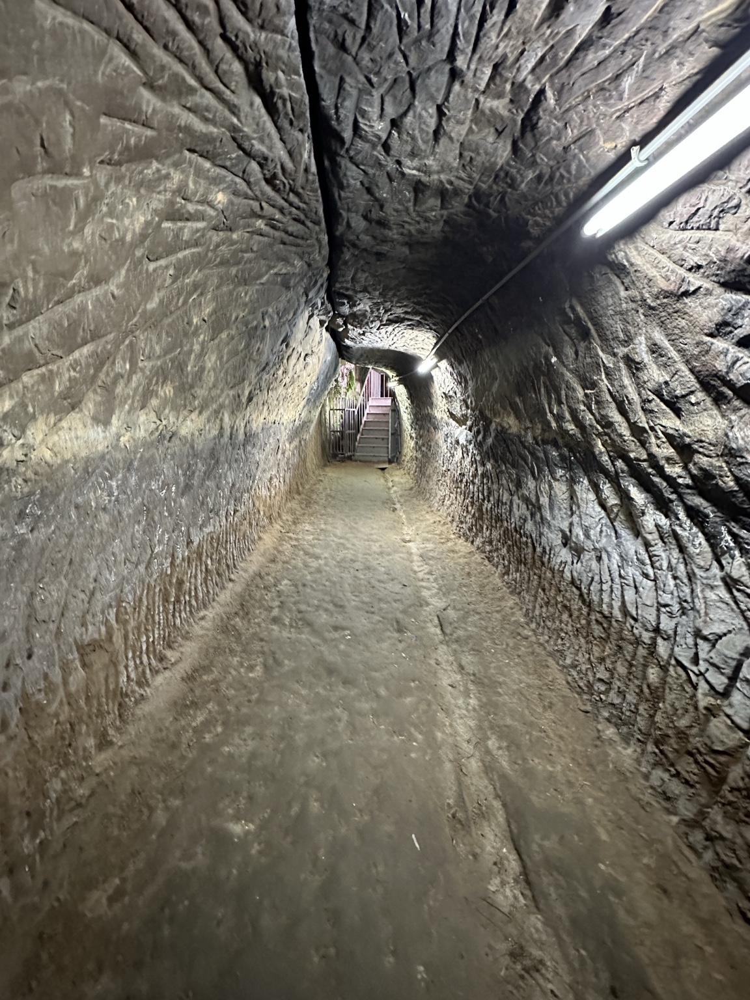

石硿內部的人工鑿刻痕跡與水流留下的痕跡。

這一段走讀，從階梯開始，也從一面意象牆開始。視線往上，故事也跟著打開；從看見水圳的圖像，到走進真實的石硿，我們一步一步靠近那段人與水共同留下的歷史。

【2026-10-01-04】萬善同歸

記住那些修圳的人

眼前的「萬善同歸」石碑十分簡樸。

如果只是匆匆走過，很容易把它當成一方不起眼的石碑；可是當我們知道它所承載的故事，再回頭看它，心裡的感受就不一樣了。

資料記載，這裡與當年修築瑠公圳時罹難、且無親屬祭祀的人員有關。

想像當年的人們，為了讓水能夠被引進來、讓土地得到灌溉，必須付出大量的人力。那些曾經參與修圳的人，有些人的名字也許早已無從得知，但他們曾經在這片土地上留下自己的力氣，甚至留下了生命。

多年以後，瑠公圳依然流著。

我們今天走在圳道旁，看見的是水圳、石硿與水利設施；可是「萬善同歸」提醒我們，在這條水路背後，還有一群曾經為它付出的人。

也許，這就是走讀最讓人感動的地方。

我們走的不是一條只有水的圳，而是一條有人走過、有人工作、有人付出，甚至有人留下生命的歷史道路。

所以，走到「萬善同歸」前，我想停一下腳步。

看一看這塊簡樸的石碑，也記住那些曾經為瑠公圳付出的人。

一條水圳留下來的，不只是水利工程，也是人的故事。

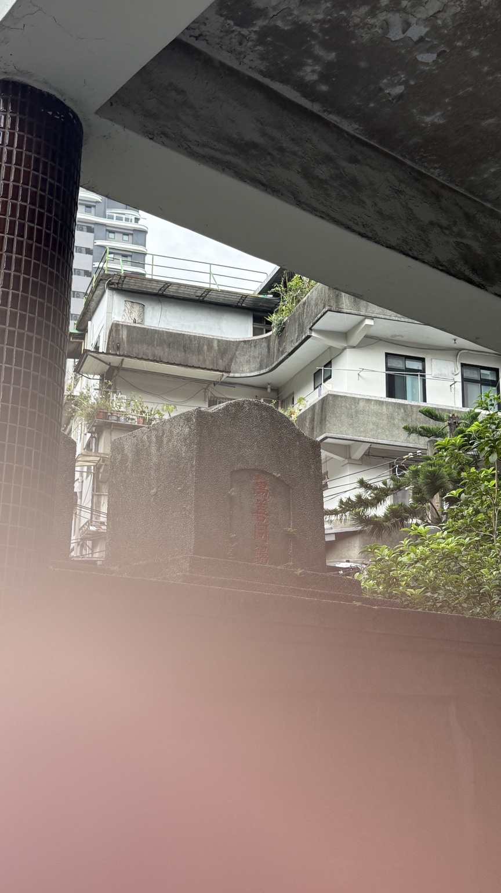

「萬善同歸」石碑。

【2026-10-02-05】蔡金木宅

一棟老宅，一段地方記憶

走到蔡金木宅前，我看到的，不只是一棟老房子。

它是一棟縱長的老屋，遠遠看去，像一列停在瑠公圳旁的小火車，有一點 choo-choo train 的趣味，因此也讓人聯想到「小長屋」。

這個名字很可愛，卻也讓我慢慢看見，這棟房子真正珍貴的地方。

一棟老宅、一棵老樹，曾經都是一個家庭最平常的日常。有人在屋裡生活，有人在樹下經過，孩子長大了，家人老去了，日子就在這裡一天天往前走。

房子記得的，往往比我們想像的更多。

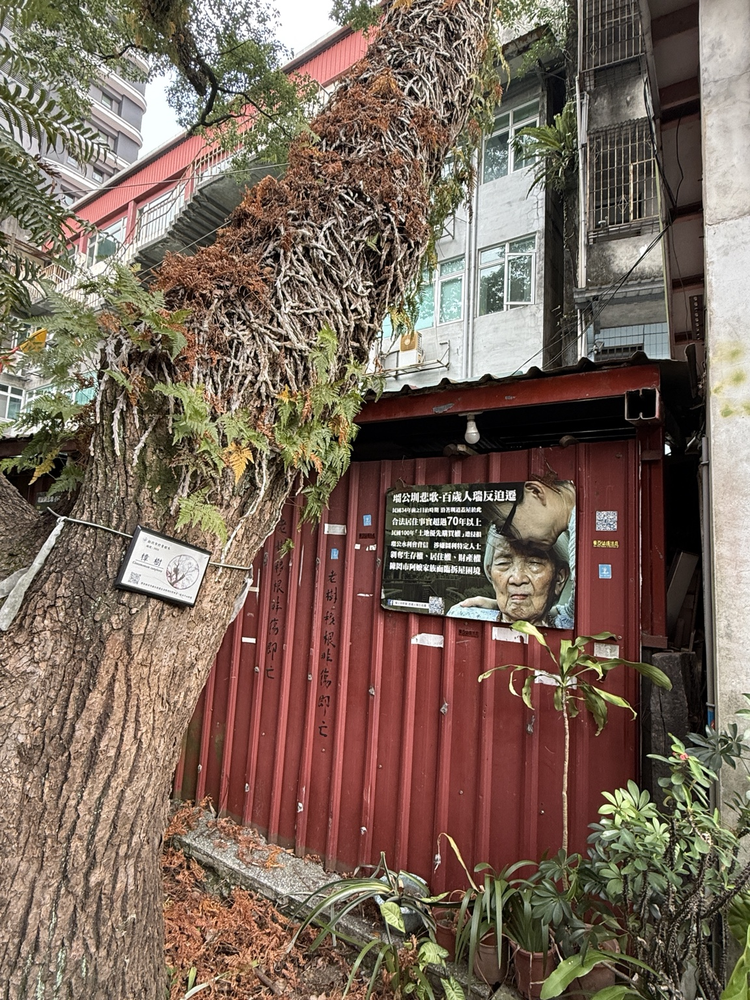

蔡金木宅老屋與老樹

可是，蔡金木宅的故事，並不只有溫暖的生活記憶。

它還有一段很長、很辛苦的保存與抗爭歷程。

現場資料中，我看到「一套法律兩種判決：夾縫求生的瑠公圳老屋」這樣的標題，也看到與老宅保存、居住與土地爭議相關的資料。眼前這棟看似安靜的小長屋，背後其實有一段延續多年的爭議。

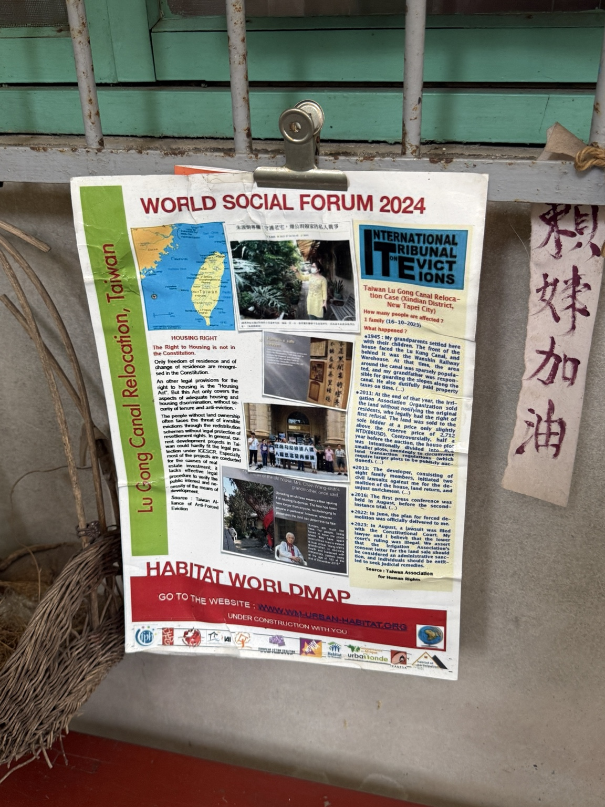

「一套法律兩種判決：夾縫求生的瑠公圳老屋」相關現場資料。

相關報導指出，蔡金木宅因土地處分與居住問題長期涉及訴訟，屋主及文史、社會團體也持續爭取老屋保存。2025年6月，老宅一度面臨強制拆除；之後因提出文化資產申請而列為暫定古蹟，強拆暫緩。

所以，當我今天站在這棟房子前，再看那一列像小火車一樣的屋舍，感覺已經完全不同。

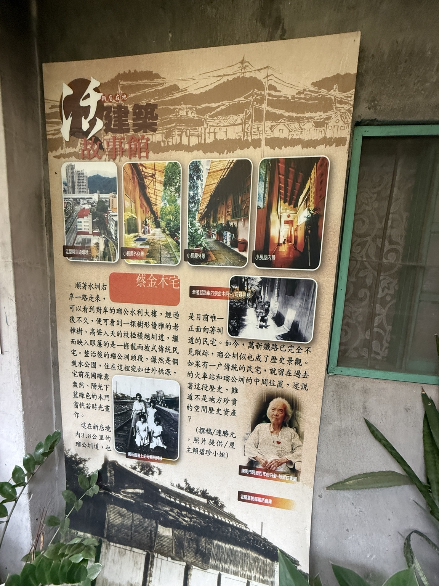

蔡金木宅與地方保存相關資料。

它不只是一棟老屋。

它是有人生活過的家，也是有人努力守住的家。

有人希望它留下來，不只是因為捨不得一棟房子，而是因為這裡留下了瑠公圳、居民生活、勞動歷史，以及新店地方發展的痕跡。

走讀經過這裡，我忽然覺得，我們不必急著回答：

這棟房子應不應該留下？

也許更重要的是，先停下腳步。

看一看它的模樣，看看它身上的歲月，也看看那些曾經在這裡生活、工作，並為它留下而努力的人。

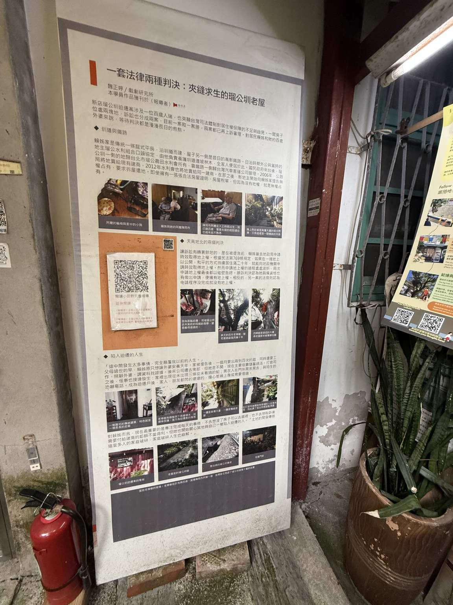

新店在地建築故事與地方保存相關資料。

因為地方不只是街道、建築和地圖上的一個位置。

地方也是人生活過、爭取過、守護過的痕跡。

水圳記住土地，老宅記住人。

而蔡金木宅讓我看見的，是一段更深的地方記憶：一棟房子可以裝著一個家庭的生活，也可以承載一群人對歷史與家園的守護。

今天我們從瑠公圳一路走來，看見水圳留下的歷史；走到蔡金木宅，我們又看見了另一種地方記憶——不是只有被保存下來的歷史，還有曾經為了保存而努力的人。

這也許就是走讀最珍貴的地方。

我們不只是看見一棟老屋，而是在一棟老屋前，看見了人、土地、生活與歷史彼此交織的故事。

蔡金木宅，不只是一棟小長屋。它是一段仍在被記住的地方記憶。

資料依據：走讀現場展示資料；中央社相關報導（2025年6月、2026年6月）及地方保存相關公開資料。

【2026-10-02-06】過水橋

大坪林圳的餘水

離開蔡金木宅後，我們繼續沿著瑠公圳往前走。

走著走著，眼前出現了一座不太起眼的橋。

第一眼看它，很容易以為這只是一座讓人通行的普通橋梁。

可是走讀就是這樣。如果只是走過去，它就是一座橋；停下來看，才會發現它原來也是水路的一部分。

走讀老師告訴我們，大坪林圳的水，就是從這座過水橋通過。

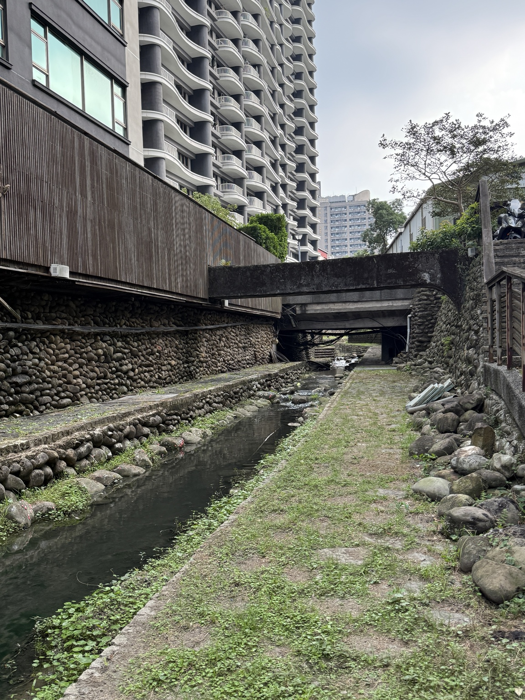

力行路一帶的圳道。

原來，橋的下面不只是道路與水圳，還有不同水路之間的交會與輸送。

眼前的水圳看起來很安靜，但它其實一直在工作。

不同方向的水路，在這裡彼此銜接；一股水流過去，另一段水路也跟著延續。

所以，瑠公圳並不是一條孤零零的水道。它是一個彼此連接的水利系統。

水走過的地方，也把土地連在了一起。

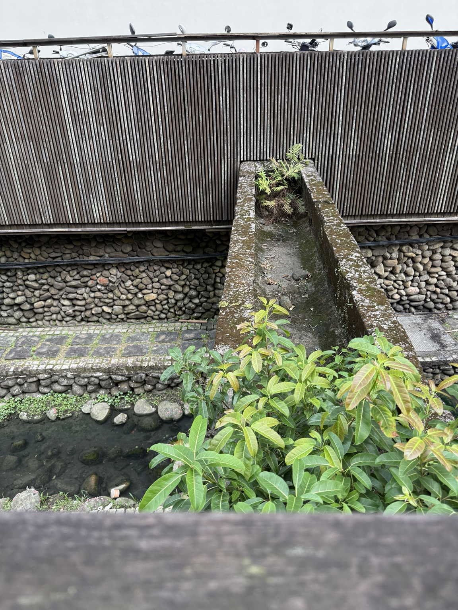

過水道與周邊水利設施。

我們平常走在馬路上，會注意道路通往哪裡。

可是今天走讀，我開始學著看另一種「道路」：水的道路。

橋可以讓人通過，水也需要自己的通道。

而這座過水橋，正是讓我們看見這件事情的一個小小窗口。

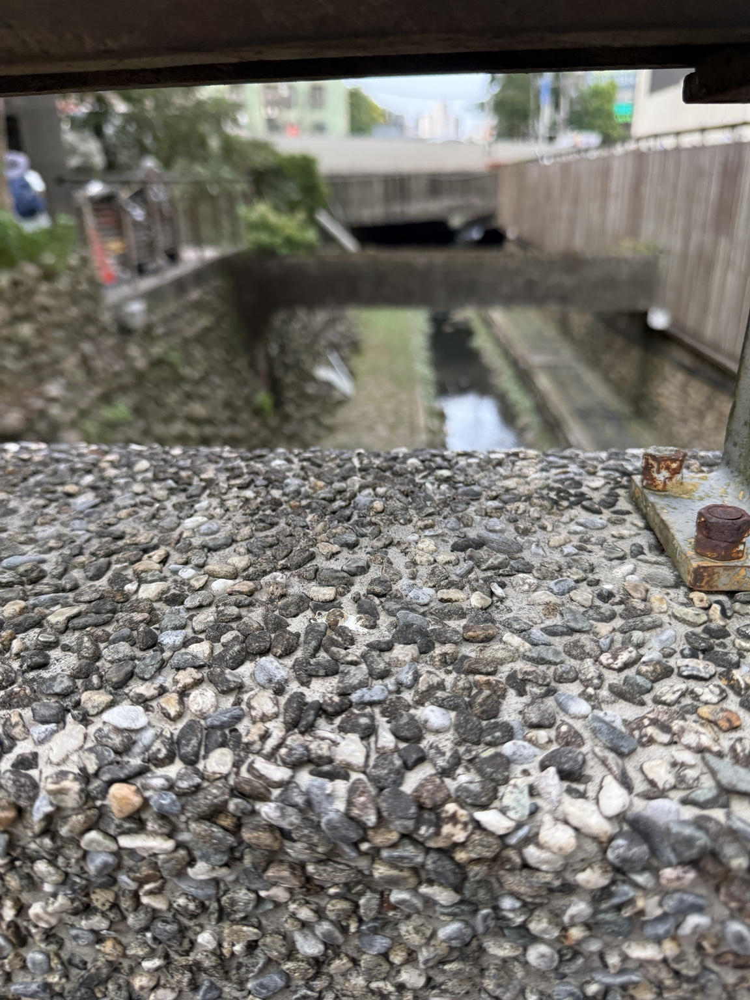

從橋下看見的水路。

站在橋上，我們看到的是一座橋。

走到橋下，看到的卻是另一個世界。

水仍然慢慢流著。橋還是那座橋。

可是當我們知道這裡是瑠公圳水利系統的一部分，就會突然覺得：原來我們剛才走過的，不只是一座橋。

我們走過的是一段仍然留在新店土地上的水路記憶。

這就是走讀有趣的地方。

有些地方，第一次經過時什麼也沒看見。老師一說，我們停下來再看一次，才發現——

原來這裡有故事。

水圳記住土地。而我們，透過一次次走讀，開始記住水圳。

這次的過水橋沒有華麗的外表。沒有大大的招牌，也沒有特別醒目的建築。

可是它安安靜靜地留在這裡，讓水繼續流過。

而我們也因為這一次停留，知道了：大坪林圳的水，沿著這套水路繼續往前走。

一座橋，讓人通行。

一座過水橋，讓水通行。

而我們走讀的人，則在橋邊停下來，讓一段差點被忽略的地方記憶，重新被看見。

【2026-10-02-07】許碧燕女士

一棟房子，一段人生

離開過水橋後，我們繼續沿著力行路往前走。

這一次，我們沒有走進一棟古蹟，也沒有去看一項水利工程，而是走進一個人的家，聽一位91歲的長者說她的人生。

許碧燕女士，民國25年次，嘉義人。22歲那年，在鄰居介紹下，她嫁給一名在力行營區當兵的軍人。當時軍人的薪水很低，而她自己的家庭也很窮，人生的選擇並不多。

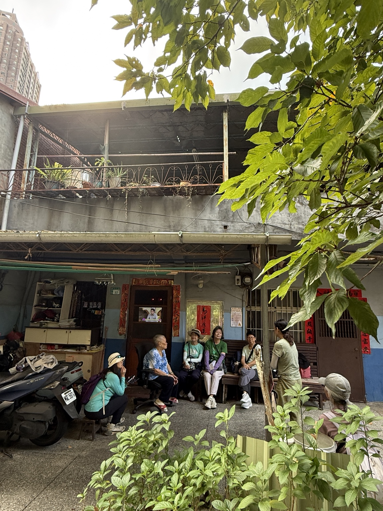

走進許碧燕女士的家，還有一樣東西讓我特別感動：牆上滿滿都是生活的照片。

一張一張，有家人、有聚會、有旅行，也有不同時期留下來的笑臉。這些照片不像博物館裡的歷史照片，而是她自己生命裡真實走過的日子。

我忽然覺得，這面牆就像一群家人，一直陪在她身邊。即使孩子們各自有了自己的生活，照片裡的人仍然每天都在這個家裡出現。

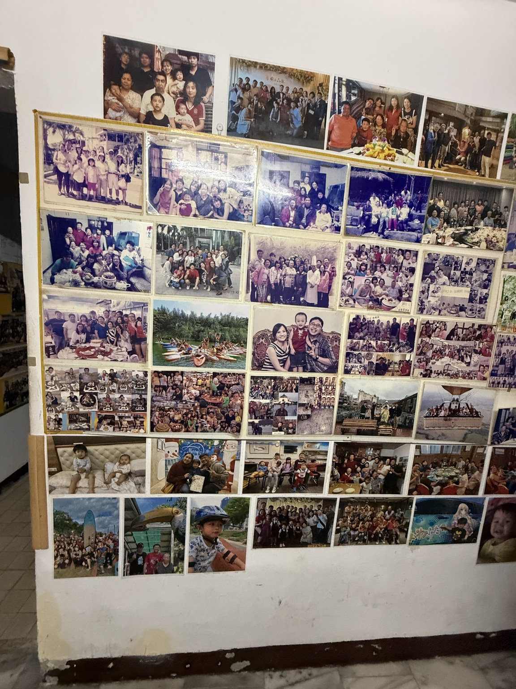

許碧燕女士家中牆上的生活照片。

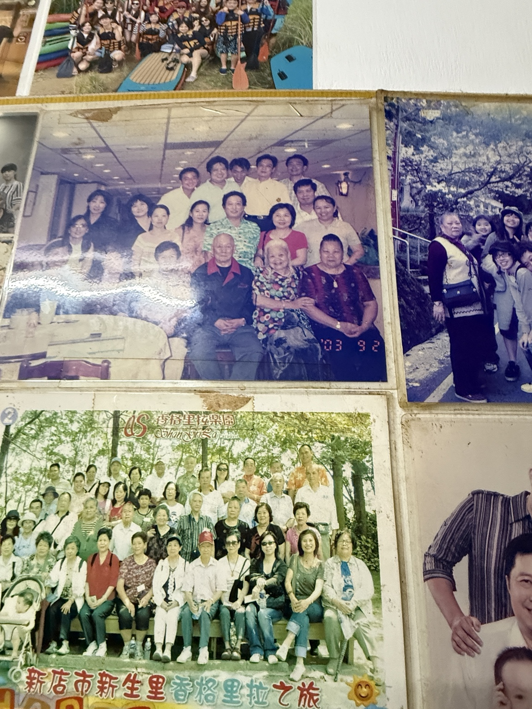

牆上留下的一張張家庭與人生記憶。

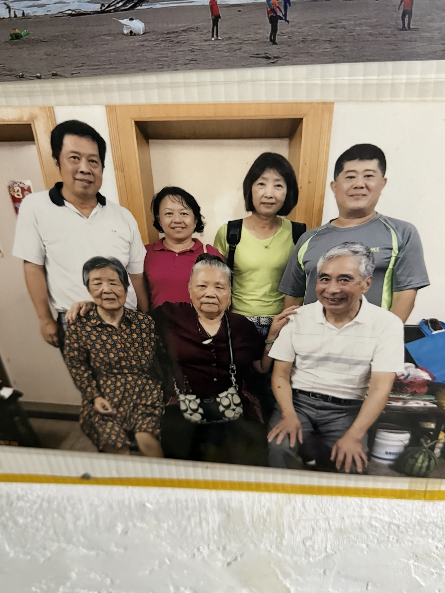

家人合影，也成為老家裡溫暖的陪伴。

對一位91歲的老人來說，這些照片也許就是最溫暖的陪伴。房子裡有人住，是一種生活；而牆上滿滿的人與回憶，則讓一個家即使安靜下來，仍然充滿了人的氣息。

可是，人生有時候就是從一個看似沒有太多選擇的起點，慢慢走出自己的路。

夫妻兩人起初租房子住。後來，他們一起挖「步垣」的砂石，用來建造自己的房子。日子慢慢好起來，又再增加兩個房間，並在二樓做了一個大的陽台。

因為一棟房子真正珍貴的地方，往往不是它有多漂亮，而是它曾經怎麼被一點一點地蓋起來。

一塊砂石、一面牆、一個房間、一個陽台，都是一家人一起過日子的痕跡。

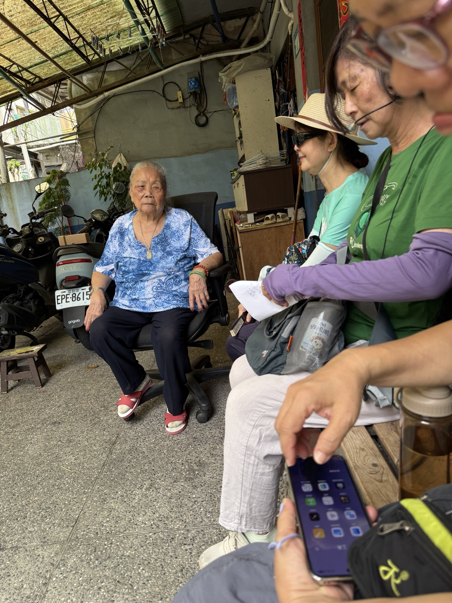

走讀訪談現場。

當我們坐在她家裡聽她說話時，眼前的老房子突然不再只是一棟房子。

它有了人的聲音，有了歲月，也有了家庭一路走過來的故事。

如今，她仍住在這棟老房子裡，和大兒子一起生活。有人賣掉老房子搬到都市，她卻喜歡這裡，覺得住在自己的老家很自在。

這一句「住在自己的老家很自在」，讓我印象很深。

因為對一個住了大半輩子的老人來說，家的意義，早就不只是房子的大小或新舊。那裡有她熟悉的生活，有她走過的歲月，也有她和家人共同留下的記憶。

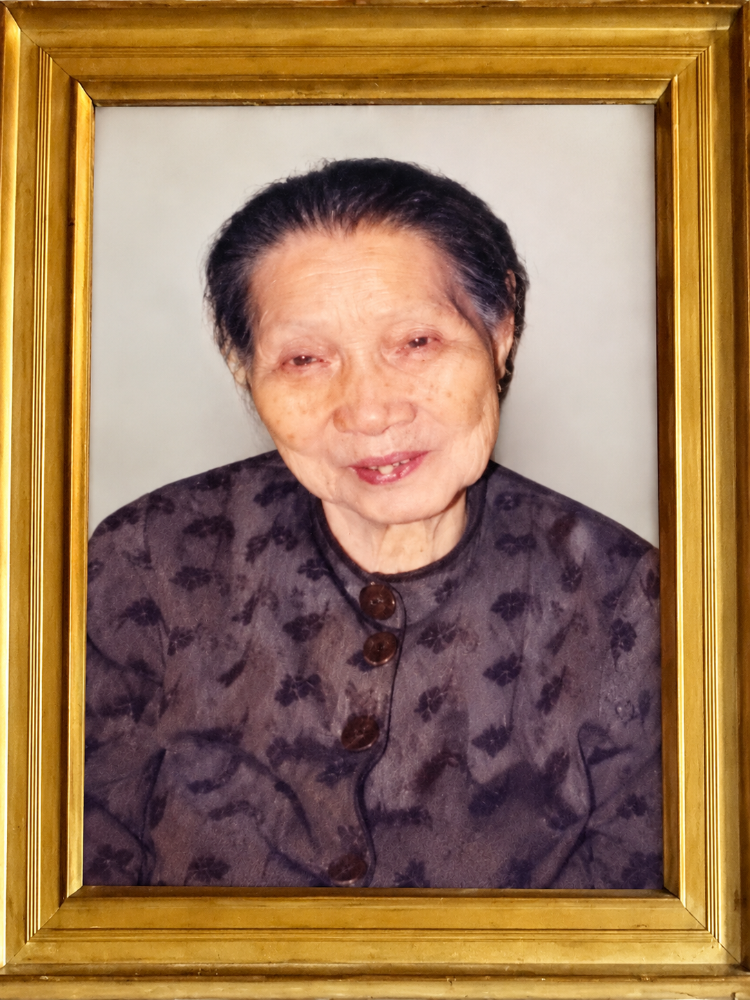

許碧燕女士母親的肖像。

她的母親肖像也留在家中。看到這張照片，我忽然想到：人走過一生，最後真正留在心裡的，常常不是那些曾經擁有過多少東西，而是我們最愛、最想念的人。

一棟老房子，可以留下生活的痕跡；一張母親的肖像，可以留下思念。

而一位91歲的老人，則讓我們親耳聽見一段從年輕走到老年的生命故事。

這也是走讀很珍貴的地方。

我們不只是走路、看房子、看街道；有時候，我們還有機會坐下來，聽一個人說她的一生。

房子留下歲月，人留下故事。

從瑠公圳的水，到過水橋的水路，再走進許碧燕女士的家，我忽然明白：

我們走讀的，其實從來不只是地方。

我們走的是一條有人生活、有人工作、有人成家，也有人慢慢老去的歷史道路。

今天，我們很幸運，還能坐在她面前，聽她說起自己的故事。

也許有一天，房子會老去，街道會改變；但只要有人願意記住，一個人的生命，就不會只是靜靜地消失在時間裡。

許碧燕女士的故事，讓我看見的不是一棟老房子，而是一個女人用一生，把一個家慢慢建立起來的故事。

【2026-10-02-08】力行營區——一座很大的通信營區

離開91歲的許碧燕女士家，我們繼續沿著力行路往東走。

許碧燕女士住在力行路，從她家一路往前走，可以慢慢看見當年力行營區留下來的空間痕跡。

今天的力行路，看起來只是新店市區裡的一條道路；但在過去，這一帶曾是力行路通訊營，也是軍人與軍眷生活的重要場域。相關資料稱這裡為新店的通信營區，早年的三軍通訊指揮部就在這一帶。

從許碧燕女士家一路向東走，營區的範圍其實相當長。一路上，我們看到道路、水圳、民宅，也看到曾經屬於營區空間的痕跡。

走到力行路11巷附近，可以看見這個路名標誌。

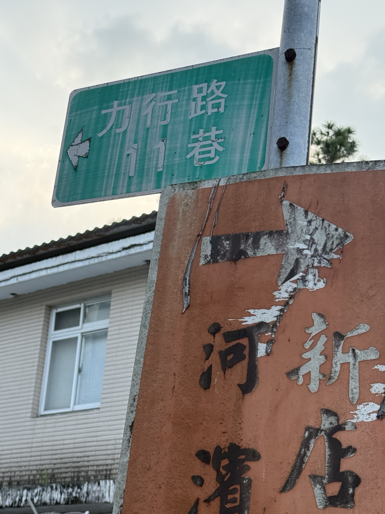

力行路11巷路牌。

力行路11巷，是我們這次走讀進入力行營區歷史空間的一個位置。路牌的右前方，就是力行營區的大門；我們走到這裡時，也只能在外面看看，不能照相。

沿路又走到熟悉的紅色欄杆過水橋。

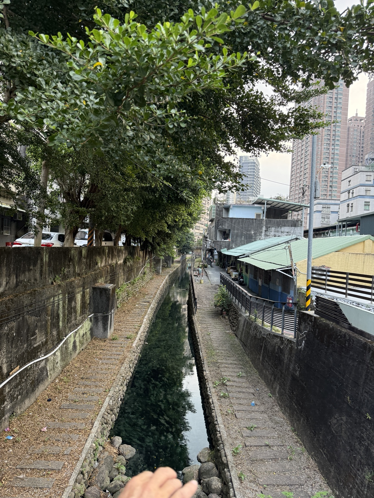

力行路旁的瑠公圳道。

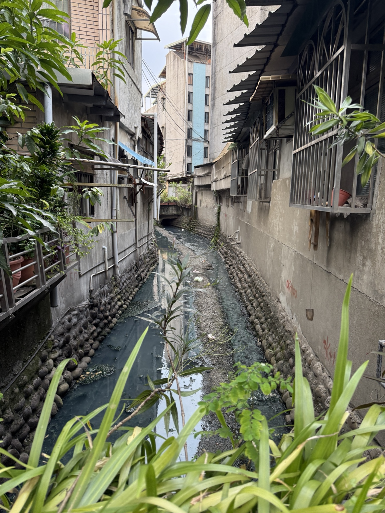

民宅之間的大坪林圳道。

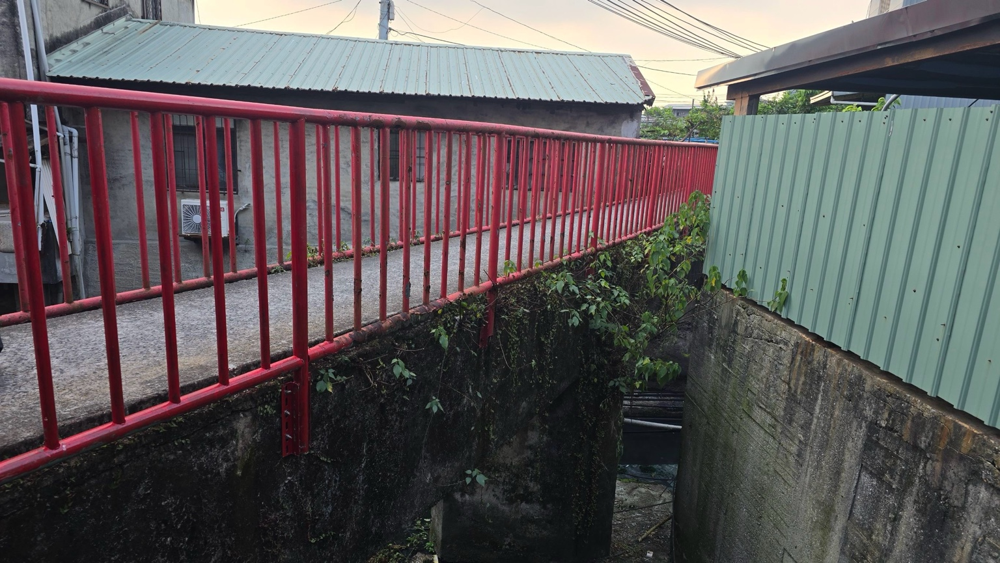

紅色欄杆的過水橋；上方為通行道路，下方為過水道。

照片來源：Maggie Chang

這座橋很有意思：橋的下方是過水道，上方則是行人與機車通行的道路。

也就是說，走在橋上，我們是在道路上通行；而橋下，原來的水路仍然繼續流動。

這條水路與力行營區的歷史空間交織在一起，也讓我們再次看到：在新店這個地方，水圳、道路、營區與居民生活，其實一直是彼此重疊的。

【2026-10-02-09】尾聲　滄海桑田，水圳仍在

沿著瑠公圳一路走到瑠公圳親水公園，最後停留在美河市附近。

左側有一棟大樓，是陸軍印製廠；美河市右側的大樓，則是立法院資料館。

而我們此刻站立的地方，正是大坪林圳加蓋後的區域。

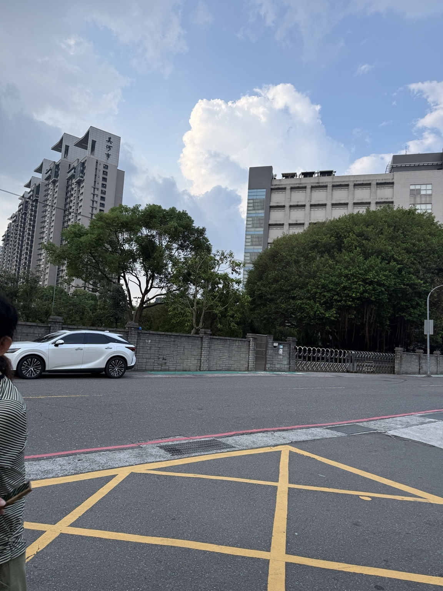

力行營區一帶的都市景觀

一路走來，原本的水圳曾經穿過田野，灌溉農田，也和沿線居民的生活緊緊相連。如今，水圳有些地方仍在地下流動，地面上則已經成為道路、建築與現代都市生活的空間。

站在這裡回頭看，忽然有一種很深的感覺：

滄海可以化為桑田，

桑田也可以再化為滄海。

地方的面貌一直在改變，水圳也跟著城市一起走過不同的時代。

而 2026 年 10 月 1 日的這次走讀，就是沿著這條水的路徑，重新把那些曾經存在過的地方，一一找回來。走讀最後停留在美河市附近所見的都市景觀。
