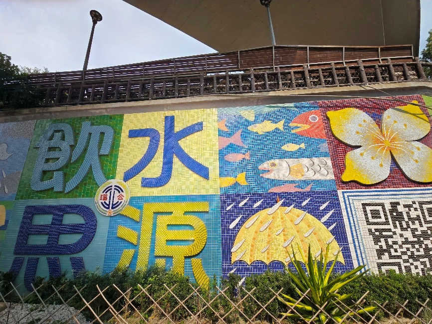
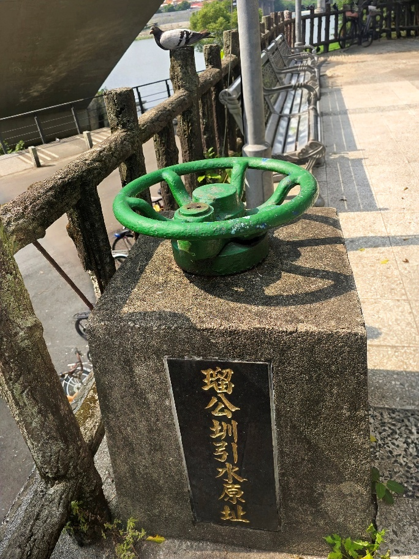
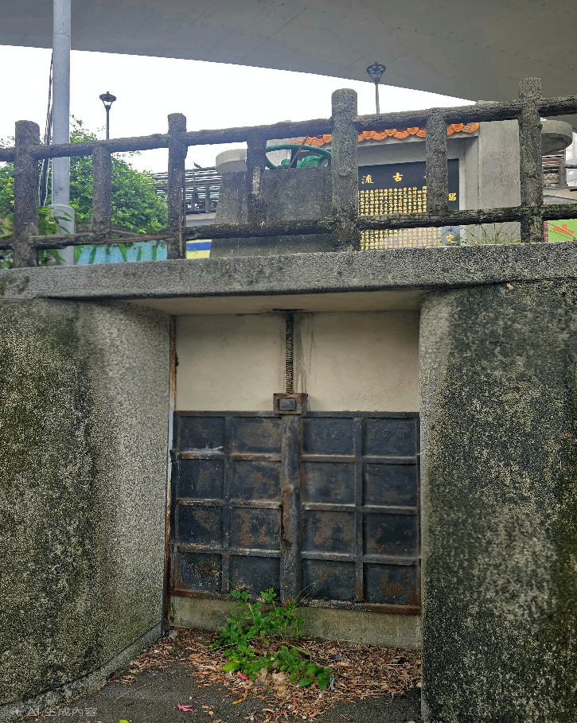
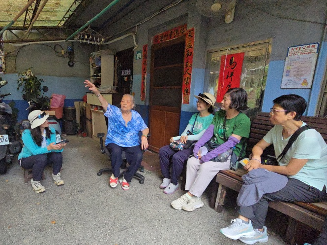
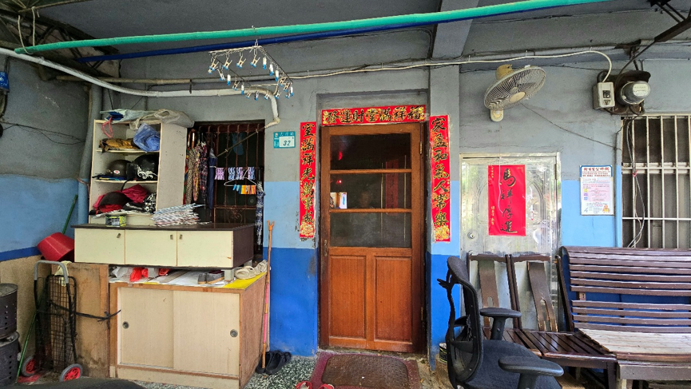
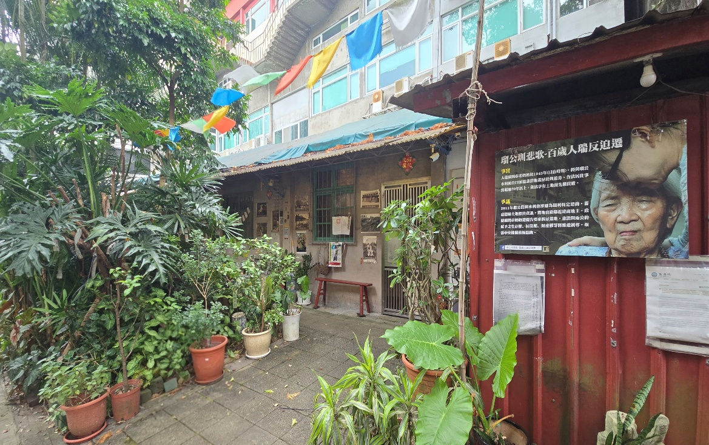
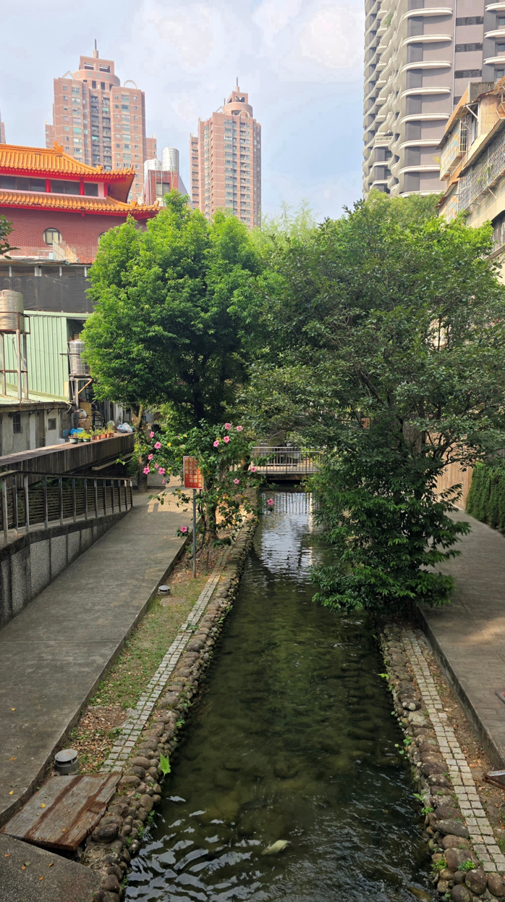
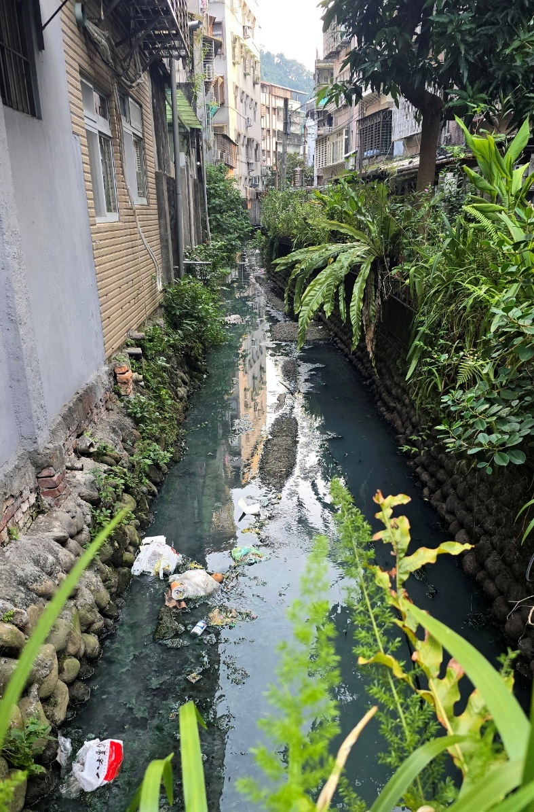

一條圳、一個家：走進瑠公圳與力行路聚落的歲月

2026年10月1日，跟著高淑華老師及崇光社大夥伴，進行「崇光社大—社區盤點之瑠公圳漫步」。從瑠公圳引水原址、水門、抽水馬達室、萬善同歸、蔡金木宅，一路走到力行路、力行營區，再到瑠公圳親水公園與三育神學院。

原本以為自己對新店已經有一定程度的熟悉，這半天的走讀，卻讓我重新看見一條「圳」背後所承載的城市記憶。

我一直很喜歡一句話：「沒有故事的城市，就像沒有靈魂、失了根的地方。」這次的社區盤點，更讓我感受到，地方的故事不一定藏在古蹟或歷史建物裡，也可能存在一條水圳、一間老屋、一面圍牆，甚至是一位老人家的生命記憶中。

從一條水圳，看見新店的發展

瑠公圳不只是灌溉水利設施，也是新店與臺北盆地發展的重要歷史脈絡。

從引水源頭談起，我們一路認識水圳開鑿的歷史，以及它如何改變農業與聚落。今天看到的圳道，早已不是當年肩負灌溉任務的模樣，但水門、圳道、過水橋，以及沿線聚落仍留下歷史痕跡。

隨著都市發展，瑠公圳的功能逐漸改變。曾經提供農田灌溉的水圳，後來與居民日常生活緊密相連，水圳周邊逐漸形成住宅與聚落。再往後，水質受到生活污水影響，原本親近居民生活的水路，也曾成為人們口中的「臭水溝」。

同樣一條水圳，在不同時代扮演著不同角色，也見證了新店從農業社會走向都市化的過程。

瑠公圳引水水閥及水門意象

一群沒有眷村名分的人，自己蓋出一個家

這次盤點最讓我印象深刻的，是力行路非列管眷舍聚落。

1950年代，部分軍人因無法分配到正式眷舍，只能自己找地方安身。當時力行路附近有忠信軍營、通信指揮部與陸軍印刷廠，軍人工作與生活都在附近，瑠公圳旁又有空地，於是有人自己挖土、找材料、搬磚，一磚一瓦蓋起房子，逐漸形成特殊的自力造屋聚落。

他們不是一般所熟悉的「眷村」，甚至沒有完整的土地權利，卻在這裡生活了幾十年。

房子從簡陋的木屋開始，慢慢增加廚房、廁所，再逐步改善居住環境。那些磚牆與屋頂，留下的不只是居住痕跡，也是居民靠自己雙手建立生活的證明。

如果只看土地權狀，這裡可能只是「沒有土地權的房屋」；但從人的生命來看，這卻是一群人用大半輩子慢慢蓋出來的家。

訪問92歲 許碧燕阿姨：她說的不是歷史，是她的一生

走讀過程中，我們有機會訪問許碧燕阿姨。

許阿姨出生於民國25年，嘉義人。民國47年，22歲的她奉母之命嫁給一位外省士官長，來到新店，從此在力行路生活了六十多年。夫妻倆先在力行營區附近租屋，後來自己在圳邊蓋房子，才有了真正屬於家庭的家。

聽她說起年輕時的生活，我腦中一直浮現「胼手胝足」四個字。

那個年代，房子不是買來就可以入住，而是夫妻倆靠自己的雙手慢慢完成。整地、挖土、找材料，甚至到碧潭左岸下城搬來燒壞、不成形的磚塊，一磚一瓦把家蓋起來。

後來先生早逝，她靠洗衣、做工，把三個孩子拉拔長大。

聽到這裡，我突然覺得，眼前這間老房子已經不能只當成一棟「老屋」來看。

它其實是一位母親的一生。

裡面有她年輕時嫁來新店的身影，有夫妻共同生活的日子，有孩子出生、長大的記憶，也有先生離開後，她獨自撐起一個家庭的歲月。

如果沒有這次訪問，我們從路旁走過時，根本不會知道。

她記得的瑠公圳，是有魚、有蝦的

許阿姨談起早年的生活，最讓我感動的還是「水」。

她記得以前的瑠公圳水量很大，水深而清，裡面有魚、蝦、蛤仔，孩子可以在水邊玩耍，婦女也會到圳邊洗衣。那時候，水圳不是風景，而是生活的一部分。

再看看今天的瑠公圳，水流不大，水質也曾因生活污水而受到影響，雖經過整治，也很難成為都市裡的親水空間。

從許阿姨的記憶回頭看這條圳，我才真正感受到，城市的改變有時很矛盾。

我們希望水圳變得乾淨、安全、整齊，卻也可能在整治與都市發展的過程中，逐漸失去它原本與居民生活緊密相連的樣子。

水圳還在，但屬於上一代人的生活記憶，卻可能慢慢消失。

「家」與「土地」不一定是同一件事

許阿姨的故事，讓我重新理解力行路聚落最難解的問題——「家」與「土地」之間的矛盾。

居民知道土地不是自己的，卻在這裡生活了幾十年；有門牌、有水電、有鄰里生活，也曾為了居住問題組成自救會向政府陳情。民國57年，甚至留下蔣經國要求軍方重新修築圍牆、讓居民安心居住的記憶。

然而，居住的事實始終沒有轉化成完整的土地權利。

多年後，瑠公圳開始整治，周邊土地價值提高，這群在此生活大半輩子的人，反而面臨拆遷問題。

2009年相關報導指出，瑠公圳空間再造第二期涉及力行路、力行路11巷及中華路83巷，共107戶、約300多名居民。居民組成自救會，希望政府在改善環境的同時，也能思考居民的安置與生活權益。

再回頭聽許阿姨談她的家，我才更能理解，那個「家」不是一個抽象的概念，而是六十多年生活累積出來的重量。

訪問許碧燕女士

一邊是蔡金木宅，一邊是力行路

這次盤點另一個讓我印象深刻的地方，是瑠公圳沿線不同形式的「有屋無地」。

一邊是蔡金木宅，一棟與瑠公圳、水利發展及地方生活密切相關的老屋；另一邊則是力行路聚落，一群軍人與眷屬靠自己蓋出來的家。

兩個地方的故事不同，卻共同面對「人可以在土地上生活一輩子，卻不一定擁有土地」的課題。

蔡金木宅曾因土地出售、拆屋還地及文化資產問題經歷長年爭議；力行路居民則在瑠公圳整治與都市發展過程中面臨拆遷。

站在今天的新店街頭，看著高樓大廈的背後是低矮破舊的老屋，我突然覺得，這其實就是一部縮小版的新店發展史——從水圳、農田，到軍營、聚落，再到現代都市與水岸景觀。

即將面臨被拆遷的蔡金木宅

每一次城市改變，都有人迎來新的生活，也有人告別原來的生活。

我眼中的文史盤點

以前參加走讀，我習慣尋找古蹟、老建築、碑文，拍下照片、記下年代，覺得這就是保存歷史。

但這次訪問許阿姨後，我對「文史盤點」有了不同的理解。

盤點的不只是老房子，而是房子裡的人。

盤點的不只是水圳的位置，而是曾經在水圳邊洗衣、抓魚蝦、養孩子的人。

盤點的不只是軍營與眷舍的名稱，而是那些沒有正式列入眷村名冊，卻在這裡生活了大半輩子的人。

許阿姨不是甚麼歷史學者，但她記得丈夫、孩子、鄰居，也記得那條曾經清澈、可以抓魚的瑠公圳。

這些生活記憶，正是地方最珍貴的文史。

一條圳，留下的不只是水

走完今天的路，我回頭看瑠公圳，已經不再只把它當成一條水圳。

它曾經是灌溉農田的生命線，也是居民生活的一部分；看過軍人落腳、家庭成長，看過老屋興建與聚落變遷，如今又以親水公園與都市景觀的模樣出現在我們面前。

城市一直往前走，但歷史不應該只留下「變漂亮」之後的樣子。

很珍惜這次社區盤點，讓我們有機會坐下來，聽一位老居民說她的人生。也許有一天，老房子會消失，圳道旁的景觀會再改變，高樓取代低矮房屋，但只要我們願意把故事記下來，那些曾經在這裡努力生活過的人，就不會真正從城市裡消失。

一條瑠公圳，流過兩百多年。

一個力行路的家，也走過六十多年。

水會流走，房子會改變，但人的故事，值得留下來。   瑠公圳整治前後段現況--從清水到髒臭不堪，之後只好加蓋隱藏在馬路之下了！2026.10.01
