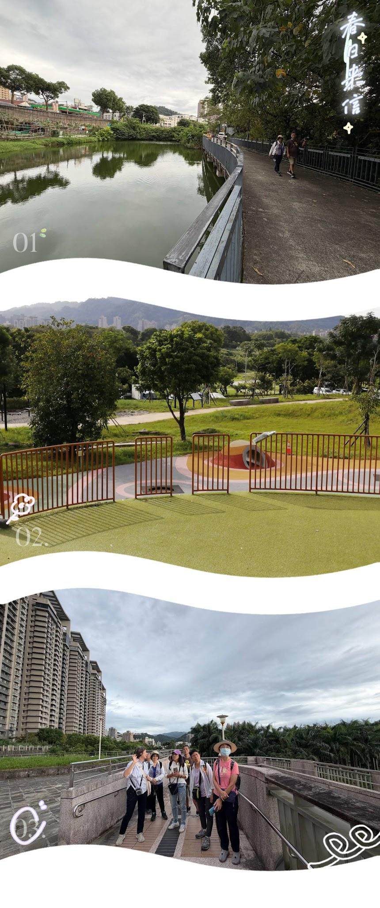
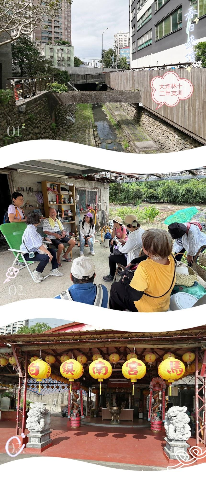
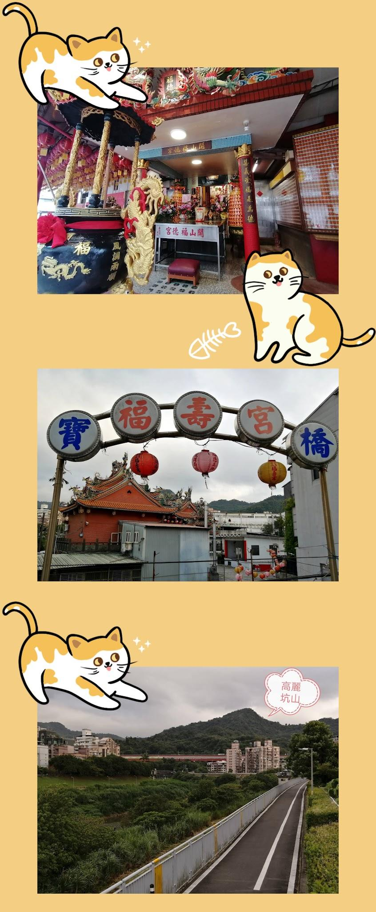
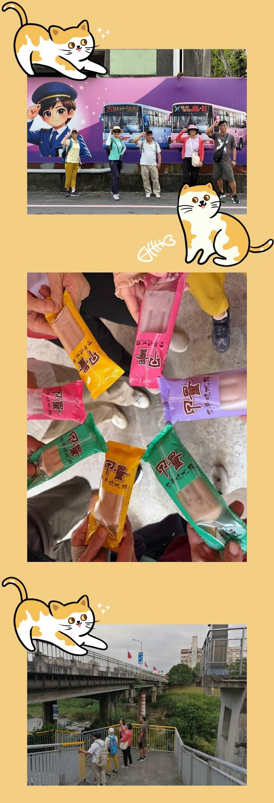

​圳水川流  孕育大地

一、 大坪林圳新建的歷史背景與演變

​引水石硿的艱辛工程：先民克服嚴峻地形與右岸岩壁阻檔，動員大量人力在岩壁中開鑿百餘公尺的「引水石硿」（今開天宮下方）。

​完工通水與產權演變：引水水路於乾隆27年（1762年）正式通水，初期由蕭妙興等人接手，後調整為八股管理。

​日治時期的公共化：明治34年（1901年）納入「公共埤圳」受官方監督，後併入水利組合，戰後歸入瑠公農田水利會。

​二、 大坪林圳幹線與分流路線矩陣

| 空間節點序號 | 區域區段 | 流向與空間節點（自南向北） | 核心空間特徵 / 現代對照地標 |
| --- | --- | --- | --- |
| 1 | 取水口端 | 青潭溪源頭 → 引水石硿 | 位於新烏路旁、開天宮下方，為全圳引水起點。 |
| 2 | 過河與進城 | 新店溪右岸 → 新店老街（后街） | 沿山麓與溪畔向北，穿過新店市區舊聚落。 |
| 3 | 市區分流樞紐 | 中華路一帶 → 瑠公親水公園 | 水路進入平原後開始分流，支線交錯於市街之中。 |
| 4 | 東西幹線分佈 | 西幹線：力行路、新生街、大坪林一帶 東幹線：北新路東側、寶橋路周邊 | 灌溉新店五庄（十二張、十三張、大坪林等廣大農田）。 |
| 5 | 末端與排水 | 各支線匯聚 → 景美溪畔（舊稱「梘頭」） |  |

三、 大坪林五庄重要土地公廟歷史點

​十四張：斯馨祠：建於清乾隆四十四年（1779年），新店最古老的土地公廟與母廟分香來源（現址位於央北二路206巷2號）。

​十二張：咸亨宮：清道光年間重修之十二張信仰中心（現址位於自由街2號）。

​二十張：二十張福德宮：百年前設立於大坪林圳尾，後多次遷移（現址位於復興路80巷1號）。

​寶斗厝：寶橋福壽宮：巍立於景美溪畔、寶橋附近，見證渡口與水圳交會處的歷史。

​七張：開山福德宮：隨聚落開墾而由斯馨祠分香設立之庄頭土地公祠（位於檳榔路周邊）。

走讀相簿集錦

2026.10.8大坪林圳西幹線

l2026.10.15大坪林圳東幹線
