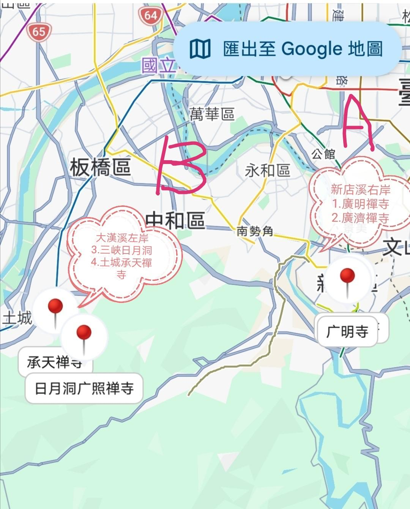
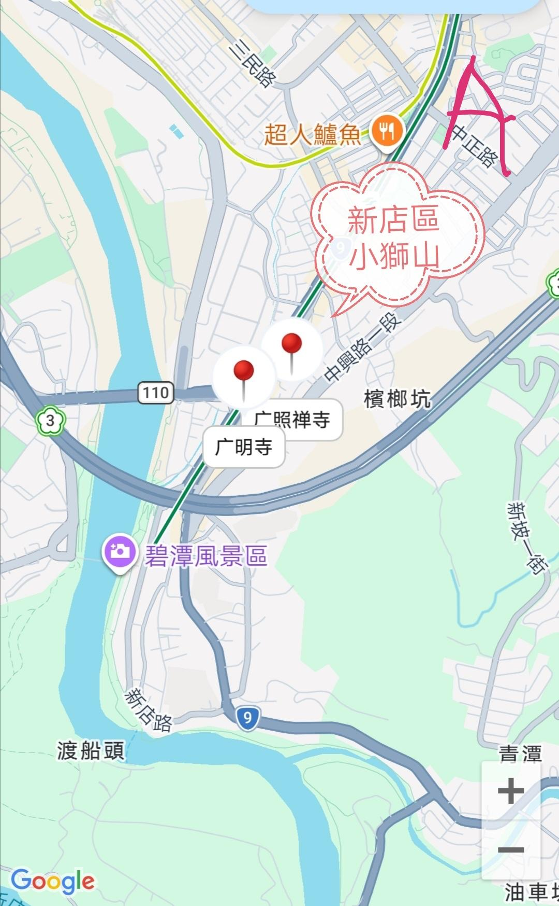
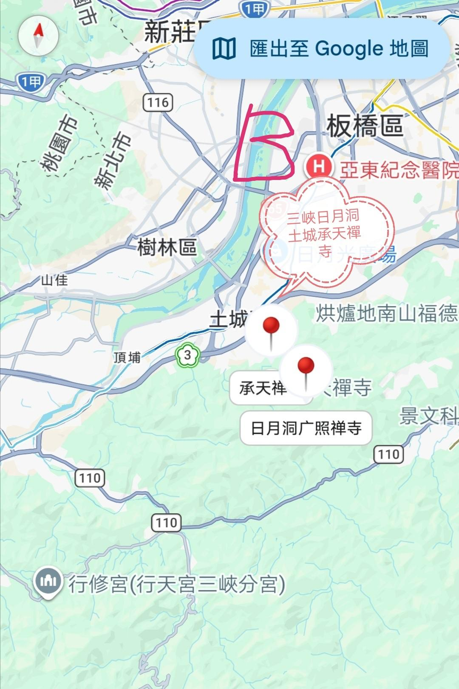

首先要感謝高淑華老師帶領參訪廣明寺和廣濟禪寺。好奇心起，想借重Google Map的協助，拼圖廣欽老和尚修行的弘法足跡。

由新店市區山麓一路西行、翻越天上山脈走向土城區，見證廣欽老和尚的「初來乍到開山」「入山頭陀苦修」「建立大型叢林」的修行軌跡。

個人觀察：

廣欽老和尚最初選擇落腳在新店溪右岸小獅山，最後安身於大漢溪右岸南天母山。二者地貌「背山面水，玉帶環腰」極佳的風水寶地。佛法廣濟新店丶三峽丶土城的黎民百姓🙏🙏🙏
